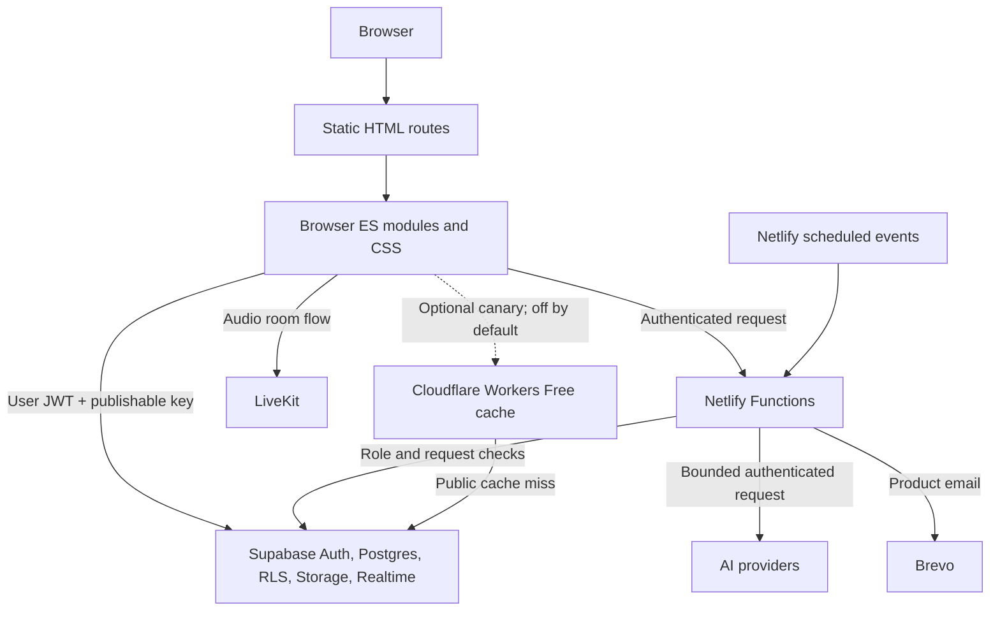
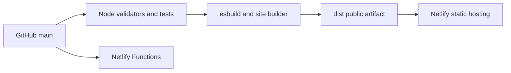

# Blipmood architecture

This map describes repository implementation, not proof that every feature or integration is enabled in production.

## System overview

## Runtime boundaries

- **Browser:** root HTML pages; styles in `assets/css/`; browser modules in `assets/js/`. The browser uses a Supabase publishable/anon key and the member session. It must not hold service credentials or third-party provider secrets. Postgres grants and RLS enforce access; hiding UI is not authorization.
- **Netlify Functions:** API/scheduled handlers in `netlify/functions/`; shared auth/request helpers in `netlify/functions/_lib/`. Each endpoint has its own contract, so inspect the handler rather than assuming all endpoints have identical permissions. The AI proxy authenticates callers, bounds input/output, applies per-user limits and reads provider keys server-side.
- **Supabase:** Auth, Postgres, RLS, Storage and Realtime. New schema belongs in timestamped `supabase/migrations/` files after checking the actual catalog and applied ledger. Migration history is incremental; root SQL snapshots are not a fresh-project baseline. `docs/sql/` is review-only.
- **Other services:** Brevo handles product mail on the server; Supabase Auth SMTP is separately configured. LiveKit supports audio spaces. Cloudflare Workers are separate projects and the media client route is off by default.

Authorization uses trusted `app_metadata` and/or database-backed roles. Never trust `user_metadata.role` or browser-supplied role values. Keep private chat, restricted-community media and expiring Stories on private ownership-checked paths.

## Build and deployment

- Node 22 is pinned by `.nvmrc` and package engine.
- `scripts/run-checks.mjs` orchestrates `npm run check`.
- `scripts/build-site.mjs` creates `dist/`, bundles CSS/vendor assets and copies public pages/assets while excluding internal docs, migrations, scripts and server source.
- `netlify.toml` publishes `dist` and points Functions to `netlify/functions`.
- Code, schema migrations, provider settings and production deployment are separate operations. Read [Production Readiness](../PRODUCTION_READINESS.md) before release.

## Repository map

| Path | Responsibility |
| --- | --- |
| Root `*.html` | Page entry points and module scripts |
| `assets/js/` | Browser feature modules/shared helpers |
| `assets/css/` | Shared, page-specific and responsive styles |
| `netlify/functions/` | API and scheduled handlers |
| `netlify/functions/_lib/` | Shared Function utilities |
| `supabase/migrations/` | Versioned schema changes |
| `docs/sql/` | Review-only SQL proposals |
| `cloudflare/` | Separate Worker projects |
| `scripts/` | Build and validation |
| `tests/` | Node, handler, contract and browser tests |
| `docs/` | Current architecture, audits, feature and release notes |
| `docs/archive/legacy-guides/` | Superseded guides retained for history |

## Trace a feature

1. Find the HTML route and its module entry point.
2. Locate the event handler, state owner and imported helpers.
3. Identify direct Supabase queries/RPCs or the exact Function request.
4. Inspect browser session, Function authorization, grants and RLS.
5. Find the migration, Storage policy or provider adapter.
6. Follow the response to visible loading/empty/success/failure states.
7. Locate focused Node, migration-contract and/or Playwright tests.

Search for existing implementations before adding a module, endpoint or RPC.

## Domain starting points

| Domain | Browser/UI | Server/data |
| --- | --- | --- |
| Feed/posts | `app.js`, `post.js`, `data.js` | Posts, engagement/feed schema |
| Auth/profiles | `user-auth.js`, `profile.js`, `supabase.js` | Supabase Auth and profile migrations |
| Messaging | `chat-v2.js`, focused chat helpers | Chat tables/RLS, signing, Realtime |
| Communities | `community-forum.mjs`, `discussion.html` | Community migrations and moderation |
| Video/Stories | `videos-marketplace.js`, `video-discovery.mjs`, `stories.js` | Upload/view/private-media handlers |
| Curation | `creator-studio.mjs`, `curator.js`, `curator-ui.js` | Scout/curator Functions |
| Staff/moderation | `admin.js`, `moderator-ui.js`, `admin/`, `super/` | Role-aware Functions, audit and RLS |
| Audio spaces | `live-spaces.mjs` | Spaces Functions, LiveKit |
| Marketplace/rewards | `videos-marketplace.js`, Blip Earn modules | Marketplace and rewards Functions |
| AI | AI chat/settings modules | `netlify/functions/llm-proxy.js` |

These are starting points, not exhaustive ownership declarations. Confirm current imports and route wiring before editing.

## Constraints

- This is a static HTML/ES-module application, not React/Next.js. Do not introduce a framework as a readability shortcut.
- Some controllers remain large and share module state. Refactor them incrementally by extracting cohesive helpers with explicit contracts and tests; do not split by line count alone.
- Mocked tests do not prove live RLS, SMTP, LiveKit, provider delivery or throughput.
- Cloudflare media routing remains disabled by default. Follow its canary gates before any rollout.
